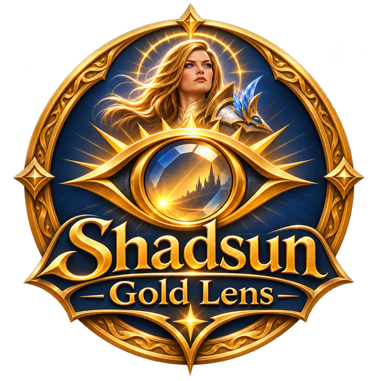

# Shadsun Gold Lens

Add-on **World of Warcraft Forever** (interface en français) pour gagner de l'or entre les marchands PNJ et les hôtels des ventes, accompagné d'une application de bureau Windows qui télécharge les prix des HDV.

Créé par Shadsun (Tarak Ben Abda).

## Ce que fait l'add-on

- **Infobulle enrichie** sur chaque objet :
  - achat et vente PNJ ;
  - prix des HDV Alliance, Horde et neutre ;
  - bénéfice net ;
  - marchand le plus proche ;
  - quantité possédée sur vos personnages.
- **Opportunités** : PNJ » HDV (acheter chez un marchand, revendre à l'HDV), HDV » PNJ, HDV » HDV.
- **Listes d'achat** : progression, meilleur prix par HDV, tri, filtre « là où ce personnage peut acheter ».
- **Panneau à l'hôtel des ventes** : scan complet ou ciblé. L'achat reste toujours manuel.
- Compatible avec Auctionator et TomTom, facultatifs.

## L'application de bureau

`ShadsunGoldLens.exe` :
- installe l'add-on ;
- met à jour les prix des HDV toutes les heures, sans compte développeur grâce à Forever AH, ou avec votre clé Blizzard ;
- propose les nouvelles versions de l'add-on publiées ici.

## Installation

1. Téléchargez la dernière version : **[page des versions](https://github.com/TarakBenAbda/Shadsun_Gold_Lens/releases/latest)**.
   - `ShadsunGoldLens.exe` : l'application, qui installe aussi l'add-on. C'est le plus simple.
   - `Shadsun_Gold_Lens_vX.Y.Z_WoW_Forever.zip` : l'add-on seul, à décompresser dans `World of Warcraft\_forever_\Interface\AddOns\`.
2. Windows peut afficher « Windows a protégé votre ordinateur », car l'exe n'est pas signé : cliquez **Informations complémentaires**, puis **Exécuter quand même**.
3. En jeu : `/sgl`, ou le bouton de la mini-carte.

Documentation détaillée :
- [add-on](ShadsunGoldLens/LISEZ-MOI.md) ;
- [application](src/tools/prix_api/LISEZ-MOI-APPLICATION.md) ;
- [clé Blizzard](src/tools/prix_api/GUIDE-API.md) ;
- [journal des modifications](ShadsunGoldLens/CHANGELOG.md).

## Contenu du dépôt

| Dossier | Contenu |
|---|---|
| `ShadsunGoldLens/` | l'add-on (Lua) |
| `src/tools/prix_api/` | l'application de bureau (Python) et son moteur de prix |
| `src/tests/` | tests : client WoW simulé, faux serveurs (Blizzard, Forever AH, GitHub), interface |
| `src/tools/` | outils de construction de la base de données |
| `.github/workflows/` | publication automatique des versions |

Chaque version publiée a passé tous les tests sur GitHub Actions. Les tests de l'add-on utilisent un client simulé : le comportement dans le jeu est vérifié à la main.

## Signaler un problème

Ouvrez une [issue](https://github.com/TarakBenAbda/Shadsun_Gold_Lens/issues) avec une capture et, si possible, le résultat de `/sgl diag` en jeu.

## Licence et sources des données

GPL v3 (voir [LICENSE](LICENSE)).

Les données des marchands viennent notamment de [QuestieDB](https://github.com/Questie/QuestieDB) (GPL v3), de [CMaNGOS Classic DB](https://github.com/cmangos/classic-db) (GPL v3), de [pfQuest](https://github.com/shagu/pfQuest) (MIT) et d'[Efficient Games / EG Link](https://github.com/JIVESCORP/eg-link-output-wowf) (CC BY 4.0). Prix sans clé : [Forever AH](https://forever-ah.com). Le détail est dans [ShadsunGoldLens/LISEZ-MOI.md](ShadsunGoldLens/LISEZ-MOI.md#8-sources-et-licences).

World of Warcraft est une marque de Blizzard Entertainment. Ce projet n'est ni affilié à Blizzard, ni approuvé par Blizzard.
